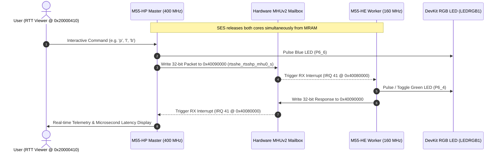

# Example 07: Dual-Core Asymmetric Multiprocessing (AMP) IPC over ARM MHUv2

This example demonstrates high-performance, real-time **Asymmetric Multiprocessing (AMP)** and **Inter-Processor Communication (IPC)** between the **Cortex-M55 High Performance (HP)** core and the **Cortex-M55 High Efficiency (HE)** core on the Alif Semiconductor Ensemble E8 DevKit (`AE822FA0E5597LS0`).

---

## 🏗️ Hardware Architecture & Bus Topology

The Alif Ensemble architecture features dual ARM Cortex-M55 cores with dedicated hardware Message Handling Units (MHUv2):



### Memory Map & Base Addresses

| Processor Core | Frequency | Flash / MRAM Address | RAM (DTCM) | Primary Interface | Visual LED |
| :--- | :--- | :--- | :--- | :--- | :--- |
| **RTSS-HP (Master)** | 400 MHz | `0x80200000` | `0x20000000` (`0x20000410` RTT) | SEGGER RTT Viewer | `LED1_B` / `LED1_R` |
| **RTSS-HE (Worker)** | 160 MHz | `0x80000000` | `0x20000000` | UART2 (115200 baud) | `LED1_G` (`P6_4`) |

---

## 📡 32-Bit MHUv2 IPC Protocol Specification

Communication utilizes 32-bit single-word register messaging across MHU0 Channel 0, achieving zero-allocation, deterministic microsecond latency:

```text
 31             24 23             16 15                               0
+-----------------+-----------------+---------------------------------+
|   Opcode (8b)   | Sequence ID(8b) |      Payload / Parameter (16b)  |
+-----------------+-----------------+---------------------------------+
```

### Supported Opcodes

| Direction | Opcode | Name | Payload / Parameter Description |
| :--- | :--- | :--- | :--- |
| **Master ➔ Worker** | `0x01` | `IPC_OP_PING` | Arbitrary test parameter (e.g. `0xABCD`) |
| **Worker ➔ Master** | `0x81` | `IPC_RESP_PONG` | Worker total processed packet counter |
| **Master ➔ Worker** | `0x02` | `IPC_OP_LED_SET` | `0` = OFF, `1` = ON, `2` = TOGGLE Green LED |
| **Worker ➔ Master** | `0x82` | `IPC_RESP_LED_STATUS`| Current Green LED state (`0` or `1`) |
| **Master ➔ Worker** | `0x03` | `IPC_OP_GET_METRICS` | Request worker uptime and counters |
| **Worker ➔ Master** | `0x83` | `IPC_RESP_METRICS` | Worker RX packet counter |
| **Master ➔ Worker** | `0x04` | `IPC_OP_BURST_PING` | Fast path ping (bypasses worker UART print) |
| **Worker ➔ Master** | `0x84` | `IPC_RESP_BURST_PONG`| Echoes sequence ID |

---

## 🚀 Building and Flashing

### Automated Single-Command Script

Run the automated build and flash script inside WSL2:

```bash
cd /mnt/c/Users/test/.gemini/antigravity/scratch/alif_vscode-template/examples/07_dual_core_ipc
./build_and_flash.sh
```

### Manual Build Steps

1. **Build Cortex-M55 HE Worker**:
   ```bash
   cd ~/alif/sdk-alif
   west build -p always -b alif_e8_dk/ae822fa0e5597xx0/rtss_he \
       /mnt/c/Users/test/.gemini/antigravity/scratch/alif_vscode-template/examples/07_dual_core_ipc/core_he \
       -d /mnt/c/Users/test/.gemini/antigravity/scratch/alif_vscode-template/examples/07_dual_core_ipc/core_he/build

   # Golden Rule #8: Rename to avoid destination collision in flat SE tool directory
   cp -f /mnt/c/Users/test/.gemini/antigravity/scratch/alif_vscode-template/examples/07_dual_core_ipc/core_he/build/zephyr/zephyr.bin \
         /mnt/c/Users/test/.gemini/antigravity/scratch/alif_vscode-template/examples/07_dual_core_ipc/core_he/build/zephyr/zephyr_he.bin
   ```

2. **Build Cortex-M55 HP Master**:
   ```bash
   west build -p always -b alif_e8_dk/ae822fa0e5597xx0/rtss_hp \
       /mnt/c/Users/test/.gemini/antigravity/scratch/alif_vscode-template/examples/07_dual_core_ipc/core_hp \
       -d /mnt/c/Users/test/.gemini/antigravity/scratch/alif_vscode-template/examples/07_dual_core_ipc/core_hp/build
   ```

3. **Flash Both Binaries Simultaneously**:
   - Set switch **`SW4`** to **`SE` (Top)**.
   ```bash
   west flash -d /mnt/c/Users/test/.gemini/antigravity/scratch/alif_vscode-template/examples/07_dual_core_ipc/core_hp/build -- \
       --he-bin /mnt/c/Users/test/.gemini/antigravity/scratch/alif_vscode-template/examples/07_dual_core_ipc/core_he/build/zephyr/zephyr_he.bin \
       --he-mram-boot 1
   ```

---

## 💻 Running & Interactive Telemetry

1. **Hardware Switch Setting**: Switch `SW4` to **`UART2` (Center)**.
2. **Reset Board**: Press `SW1` (RESET).
3. **Open SEGGER RTT Viewer**:
   - Target Device: **`AE722F80F55D5_HP`**
   - Target Interface: **`SWD`** (4000 kHz)
   - RTT Control Block: **Address `0x20000410`**
4. **Interactive Commands**:
   - `[p]` : Send single Ping and display hardware round-trip latency ($\mu$s).
   - `[l]` : Remote control M55-HE Green LED (Toggle).
   - `[b]` : Run 100-packet Burst Benchmark (calculates min/avg/max latency & throughput).
   - `[s]` : Query remote M55-HE telemetry metrics.
   - `[a]` : Toggle Automated Periodic Heartbeat (every 3 seconds).
   - `[h]` : Print command help menu.

---

## 📊 Expected Output in SEGGER RTT Viewer

```text
=====================================================
  Alif Ensemble Dual-Core IPC Master (M55-HP)        
  Inter-Processor Communication via ARM MHUv2        
  Telemetry Console @ 0x20000410 | CoreSight AP[0]   
=====================================================
Master Core : Cortex-M55 HP (400 MHz)
Worker Core : Cortex-M55 HE (160 MHz)
Hardware Bus: ARM MHUv2 Mailbox (Shared Interconnect)
  - Sender Register   : 0x40090000 (rtsshe_rtsshp_mhu0_s)
  - Receiver Register : 0x40080000 (rtsshp_rtsshe_mhu0_r)
=====================================================

[Heartbeat #001] Pong OK | RTT Latency: 3 us | Remote RX Count: 1
[Heartbeat #002] Pong OK | RTT Latency: 3 us | Remote RX Count: 2

>>> [BENCHMARK] Starting 100-packet back-to-back IPC burst test...
>>> [BENCHMARK RESULTS]
    - Delivered Packets : 100 / 100 (Success Rate: 100.0%)
    - Min Latency       : 2 us
    - Avg Latency       : 3 us
    - Max Latency       : 6 us
    - Total Burst Time  : 312 us (0 ms)
    - IPC Throughput    : 320512.8 transactions / sec
```
